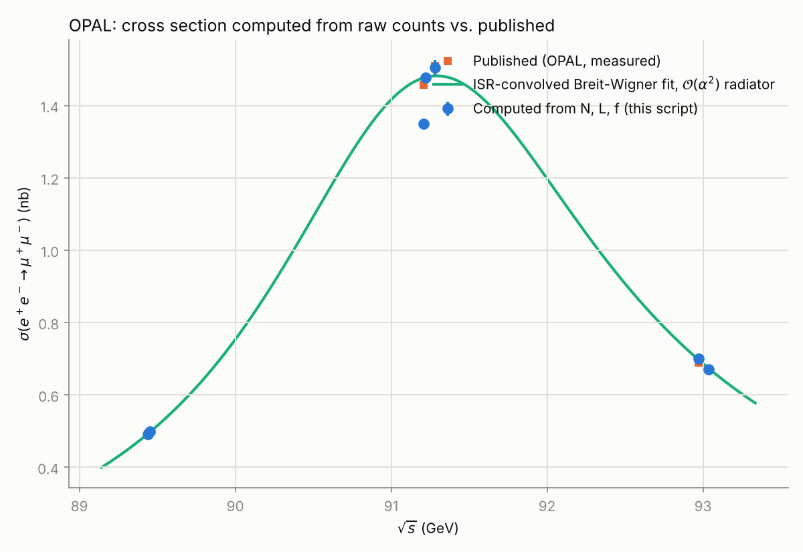
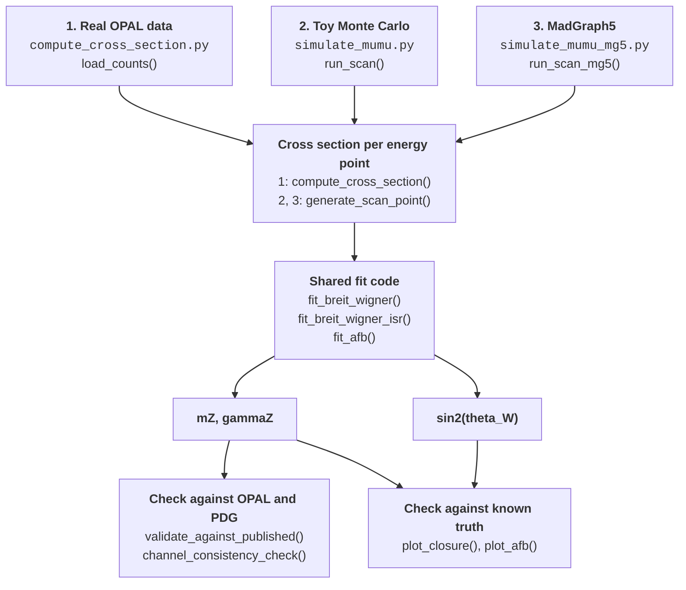
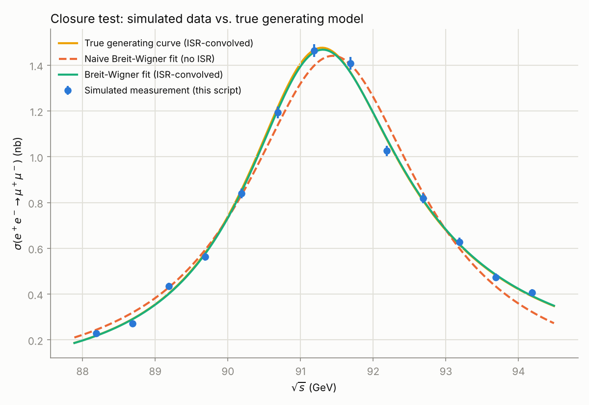
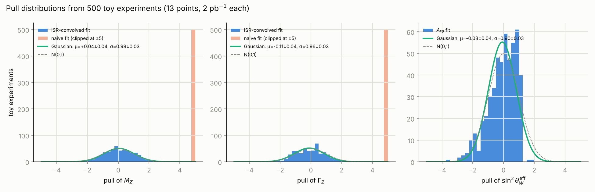
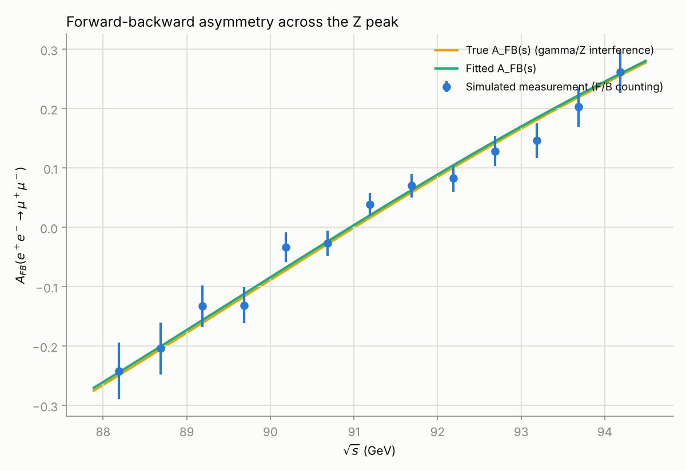
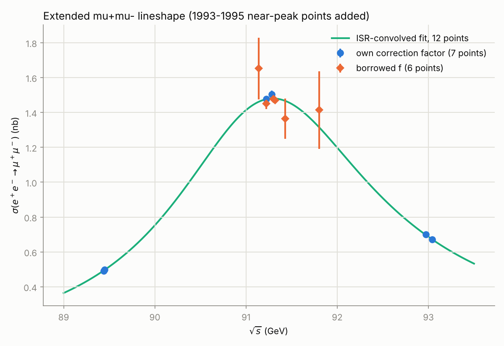
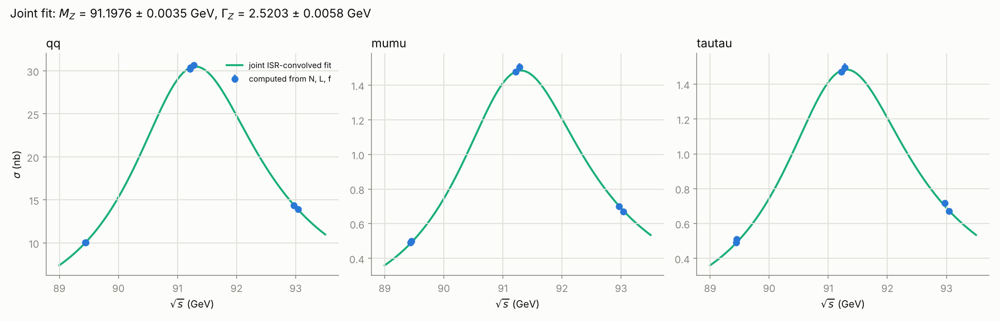

# Measuring the Z boson from raw LEP event counts

When electrons and positrons collide at around 91 GeV they can produce a Z
boson, and the collision rate rises to a sharp peak at that energy. The
position of that peak is the Z mass $M_Z$, and its width is the Z decay width
$\Gamma_Z$, set by how many ways the Z can decay. Mapping out the peak, the Z
"lineshape", was one of the central measurements at LEP.

This project redoes that measurement from the experiment's raw numbers. Given
how many events OPAL counted ($N$), how much beam was delivered ($L$, the
integrated luminosity) and how efficient the detector was ($f$), it computes
the cross section $\sigma = fN/L$ for each type of final state and fits the
peak to get $M_Z$ and $\Gamma_Z$. It also extracts the weak mixing angle
$\sin^2\theta_W$ from a second effect: the muons come out slightly more often
along one beam direction than the other, and how that imbalance changes with
energy is sensitive to $\sin^2\theta_W$. Two closure tests then check the whole
chain against data whose true answer is known in advance.

<p align="center">
  
</p>

The operative word is *computed*. A HEPData cross-section table is the
published answer with nothing left to derive. OPAL's "Zedometry" paper
([hep-ex/0012018][paper]) is unusual in tabulating the *inputs* instead --
$N$, $L$ and $f$, energy point by energy point -- and everything after that is
done here.

[paper]: https://arxiv.org/abs/hep-ex/0012018

---

## Results at a glance

| # | Question | Answer |
|---|---|---|
| 1 | Does $\sigma = fN/L$ reproduce OPAL's published $\mu^+\mu^-$ cross sections? | **6 of 7 points agree to better than 2%**, five of those to better than 0.6% |
| 2 | What about the 7th? | **1993 "peak" is $-7.4\%$ off**, and only in the two *track-based* channels ($\mu\mu$, $\tau\tau$). It is neither a typo nor a bad measurement: every channel has its own luminosity and the paper's Table 1 lists the hadronic one. The ratio computed/published is exactly $L_{\mathrm{channel}}/L_{qq}$, which makes $L_{\mu\mu}$ $8.15\ \mathrm{pb}^{-1}$ where the table says $8.8$ |
| 3 | Fit a Breit-Wigner to the clean points, giving $M_Z$, $\Gamma_Z$? | $91.459\,/\,2.792$ GeV, i.e. 271 and 297 MeV above PDG. Good $\chi^2/\mathrm{ndof}$ (0.37/3), wrong answer |
| 4 | Same fit, with QED initial-state radiation convolved in? | $\mathbf{M_Z = 91.1824 \pm 0.0119\,(\mathrm{fit}) \pm 0.0075\,(\mathrm{syst})}$ GeV, $\mathbf{\Gamma_Z = 2.5163 \pm 0.0195 \pm 0.0135}$ GeV. ISR was worth $-276$ MeV on both |
| 5 | And with what a Breit-Wigner leaves out? | Photon exchange, $\gamma/Z$ interference and LEP's running-width convention move it to $M_Z = 91.1853$, $\Gamma_Z = 2.4856$ GeV: $-0.2\sigma$ and $-0.4\sigma$ from PDG. The photon term alone is worth $-37$ MeV on $\Gamma_Z$ |
| 6 | Where does the uncertainty come from? | An [error budget](#error-budget): statistics dominate ($11.6$ / $18.8$ MeV); the per-channel luminosity that Table 1 does not list is the largest systematic ($6.4$ / $12.7$ MeV); truncating the radiator at $\mathcal{O}(\alpha^2)$ costs $3.5$ / $4.6$ MeV |
| 7 | Is that ISR machinery correct, or just tuned to land on PDG? | Toy-MC closure test against a *known* truth: the no-ISR fit lands $+18.1\sigma\,/\,+10.4\sigma$ off, the ISR fit $+0.7\sigma\,/\,+0.3\sigma$. Repeated 500 times, the ISR fit's pulls have mean $\approx 0$ and width $\approx 1$ ([pull study](#pull-study)) |
| 8 | Can a second, independent observable come out of the same events? | $\sin^2\theta_W^{\mathrm{eff}} = 0.2289\,^{+0.0043}_{-0.0035}$ from the forward-backward asymmetry (true input 0.23155, $-0.6\sigma$). The asymmetric MINOS errors have the right coverage over 500 toys; the symmetric ones did not |
| 9 | Does it still work when the truth model is not my own code? | With MadGraph5-generated events and ISR switched off at the generator, the **naive fit now wins** and the ISR fit is $-8.5\sigma$. That inversion is the correct behaviour, and is the strongest evidence the ISR correction does real work. $A_{\mathrm{FB}}$ gives $\sin^2\theta_W^{\text{on-shell}} = 0.2243 \pm 0.0071$ (truth 0.2222, $+0.3\sigma$) |
| 10 | What happens with all channels at once? | A joint $qq+\mu\mu+\tau\tau$ fit of the full $\gamma/Z$ model gives $M_Z = 91.1908 \pm 0.0035 \pm 0.0040$ and $\Gamma_Z = 2.5065 \pm 0.0058 \pm 0.0050$ GeV ($+0.6\sigma$, $+1.4\sigma$ from PDG), $R_\ell = 20.80 \pm 0.06$ against OPAL's own $20.823 \pm 0.044$, and $\sigma_{\mu\mu}/\sigma_{\tau\tau} = 1.000 \pm 0.006$ ([section 4](#4-extensions)) |

Rows 3 to 6 are the physics result. Rows 7 to 9 are the evidence that row 4
is not a coincidence. Row 10 is where the fit error meets the systematics.

---

## Quick start

```bash
python3 -m venv .venv && source .venv/bin/activate
pip install -r requirements-dev.txt   # or requirements.txt without pytest/Jupyter

python -m pytest                        # 57 regression tests, ~10 s
python src/compute_cross_section.py     # real OPAL data: rows 1-6 above, ~20 s
python src/simulate_mumu.py             # toy-MC closure test: rows 7-8
python src/pull_study.py                # 500 repeated toys, ~5 min: rows 7-8
python src/extended_fits.py             # more points, LEP lineshapes, joint fit: row 10, ~4 min
python src/simulate_mumu_mg5.py         # generator-level closure: row 9 (needs MadGraph5)
python src/simulate_mumu_mg5.py --isr   # same, with MG5's ISR on (MG5 >= 3.2, not yet run)
```

Or run everything in order, either way:

```bash
./run_all.sh                 # a banner explains each step; N_TOYS=50 ./run_all.sh is quicker
```

```bash
make all                     # tests, the four scripts, and figures/ refreshed for this README
```

`make` re-runs only the scripts whose inputs changed, and `make figures` is
how the plots embedded here are regenerated. Both take about 10 minutes from
scratch.

**New here?** [`docs/WALKTHROUGH.md`](docs/WALKTHROUGH.md) goes through each
command, what it computes, what appears on screen and how to read it, with
the expected numbers, common errors, and five one-line experiments to try.

Each script prints to stdout and writes tables and plots to `data/processed/`
(gitignored). The toy MC is seeded, so `simulate_mumu.py` reproduces the
numbers quoted here exactly. Only the MadGraph5 script needs anything beyond
`requirements.txt`. The tests, the three fast scripts and a 20-toy pull study
run in CI (`.github/workflows/tests.yml`).

---

## How it fits together



Three event sources feed one shared analysis stage. Only the source changes:
the code that turns cross sections into $M_Z$, $\Gamma_Z$ and
$\sin^2\theta_W$ is the same in all three cases, which is what lets the
closure tests say anything about the real measurement.

| Script | Event source | What it establishes |
|---|---|---|
| `compute_cross_section.py` | Real OPAL tables | The measurement itself, and that ISR matters |
| `simulate_mumu.py` | Toy MC from a known truth model | The fit recovers truth, so the ISR correction is real rather than fitted to taste |
| `simulate_mumu_mg5.py` | MadGraph5_aMC@NLO matrix elements | The truth model no longer shares an author with the fit model |

Each exists because of a hole in the one before it. Open a section for detail.

---

<details>
<summary><b>0. Theory background: where these formulas come from</b> (read this first if the rest looks like magic)</summary>

Everything below is standard electroweak theory, written out at the level the
code actually uses. Conventions: natural units $\hbar = c = 1$, metric
$(+,-,-,-)$, $s = E_{\mathrm{cm}}^2$. Cross sections come out in
$\mathrm{GeV}^{-2}$ and are converted with
$(\hbar c)^2 = 3.894 \times 10^5\ \mathrm{GeV}^2\,\mathrm{nb}$.

### 0.1 Why there is a peak at all

An electron and a positron annihilate into a single virtual particle that
then decays: this is an *s-channel* process. The intermediate Z carries the
full collision energy, so its propagator controls the rate. An unstable
particle has a complex pole, and the amplitude near it behaves as

$$\mathcal{M}(s) \;\propto\; \frac{1}{s - M_Z^2 + i M_Z \Gamma_Z}$$

The rate goes as $|\mathcal{M}|^2$, which turns the complex pole into the
resonance shape:

$$|\mathcal{M}(s)|^2 \;\propto\; \frac{1}{(s - M_Z^2)^2 + M_Z^2\Gamma_Z^2}$$

This is the Breit-Wigner. It peaks at $s = M_Z^2$ and falls to half maximum at
$\sqrt{s} \approx M_Z \pm \Gamma_Z/2$. **The peak position measures the mass,
the peak width measures the decay width** -- the entire logic of a lineshape
measurement.

The overall size needs one more ingredient: the Z must be produced from
$e^+e^-$ ($\propto \Gamma_{ee}$) and decay to the channel you look at
($\propto \Gamma_{ff}$), against a total rate $\Gamma_Z$. With the spin
counting -- 3 Z polarizations against $2\times2$ initial states -- this gives

$$\sigma^{\mathrm{peak}}_{ff} = \frac{12\pi}{M_Z^2}\,\frac{\Gamma_{ee}\Gamma_{ff}}{\Gamma_Z^2}, \qquad 12\pi = 16\pi \times \frac{3}{4}$$

PDG numbers ($\Gamma_{\ell\ell} = 83.99$ MeV) give **1.9997 nb**, which is what
LEP measured. `simulate_mumu.py` derives its truth normalization this way
rather than choosing it, which is what gives the closure test something real to
close on.

### 0.2 Fixed width, running width, and what "the Z mass" means

The $i M_Z\Gamma_Z$ above treats the width as a constant. It is not: the Z
self-energy grows with energy, so the physically correct replacement is
$M_Z\Gamma_Z \to s\,\Gamma_Z/M_Z$. The two denominators are

$$D_{\mathrm{fix}}(s) = (s-M_Z^2)^2 + M_Z^2\Gamma_Z^2, \qquad D_{\mathrm{run}}(s) = (s-M_Z^2)^2 + \frac{s^2\Gamma_Z^2}{M_Z^2}$$

These are not two competing models. They are the *same curve* with different
parameter names. Writing $k = 1 + \Gamma_Z^2/M_Z^2$, one can show exactly
(verified symbolically, not by eye) that

$$D_{\mathrm{run}}(s;\,M_Z,\Gamma_Z) = k \cdot D_{\mathrm{fix}}\!\left(s;\ \frac{M_Z}{\sqrt{k}},\ \frac{\Gamma_Z}{\sqrt{k}}\right)$$

so a fixed-width fit to running-width data returns a *smaller* mass:

$$M_Z - \bar{M}_Z = M_Z\left(1 - \frac{1}{\sqrt{k}}\right) \simeq \frac{\Gamma_Z^2}{2M_Z} = 34\ \mathrm{MeV}$$

34 MeV is not a rounding error at LEP precision, which is why the convention is
quoted with every published $M_Z$. **A mass is only comparable to PDG once you
say which propagator produced it.**

This repo uses a third form, the non-relativistic Breit-Wigner in $\sqrt{s}$:

$$\sigma(\sqrt{s}) = \sigma_{\mathrm{peak}}\frac{(\Gamma_Z/2)^2}{(\sqrt{s}-M_Z)^2 + (\Gamma_Z/2)^2}$$

Near the peak it agrees with the fixed-width form, since
$s - M_Z^2 \approx 2M_Z(\sqrt{s}-M_Z)$; it differs in the wings, and in the
numerator (constant rather than $\propto s$). Those two differences pull $M_Z$
in opposite directions on this dataset, so swapping in the full LEP form moves
the fitted mass by only $5$ MeV without ISR and by nothing with it -- a
cancellation, not an absence of the effect. The width does move, by $+6$ MeV
(section 4.2). The code converts between the conventions with
`fixed_to_running_width()`.

### 0.3 The Z is not the only thing being exchanged

$e^+e^- \to \mu^+\mu^-$ also proceeds through a virtual photon, and the photon
and Z amplitudes *interfere*. Writing the propagator ratio

$$\chi(s) = \frac{G_F M_Z^2}{2\sqrt{2}\,\pi\alpha}\cdot\frac{s}{s - M_Z^2 + i M_Z\Gamma_Z}$$

and the lepton neutral-current couplings

$$v = -\tfrac{1}{2} + 2\sin^2\theta_W, \qquad a = -\tfrac{1}{2}$$

the differential cross section in the improved Born approximation, with
$\theta$ the angle between the outgoing $\mu^-$ and the incoming $e^-$, is

$$\frac{d\sigma}{d\Omega} = \frac{\alpha^2}{4s}\Big[(1+\cos^2\theta)\,F_1(s) + \cos\theta\,F_2(s)\Big]$$

$$F_1 = \underbrace{Q_\ell^2}_{\gamma\ \mathrm{only}} - \underbrace{2Q_\ell v^2\,\mathrm{Re}\,\chi}_{\gamma/Z\ \mathrm{interference}} + \underbrace{(v^2+a^2)^2|\chi|^2}_{Z\ \mathrm{only}}, \qquad F_2 = -4Q_\ell a^2\,\mathrm{Re}\,\chi + 8(va)^2|\chi|^2$$

with $Q_\ell = -1$ entering the interference terms *linearly* (the electron's
charge is absorbed into the sign). This form agrees to machine precision with
an independent helicity-amplitude calculation.

A pure Breit-Wigner keeps only the last piece of $F_1$. The interference term
in $F_1$ carries $v^2 \approx 0.0014$ and barely touches the $\mu^+\mu^-$
lineshape; its real footprint is in $F_2$, where it enters with $a^2 = 1/4$.
The photon term is another matter once radiation is included: it is a nearly
flat pedestal of $1\%$ of the $\mu^+\mu^-$ cross section at the peak and
$2$-$3\%$ two GeV off it, and a Breit-Wigner can only absorb a pedestal by
getting wider. Section 1 measures the price: $+3$ MeV on $M_Z$ and $-37$ MeV
on $\Gamma_Z$.

Two details the code needs beyond the formula above (`src/electroweak.py`):

- **Which $\alpha$.** The $Z$ term does not depend on $\alpha$ at all in this
  $G_F$ normalization, the interference scales as $\alpha$ and the photon term
  as $\alpha^2$. At $\sqrt{s} \approx M_Z$ the improved Born approximation
  uses the running $\alpha(M_Z^2) = 1/128.947$
  ([Davier et al.](https://arxiv.org/abs/1908.00921)) rather than $1/137.036$,
  which makes the photon term $13\%$ larger. The lineshape models use
  $\alpha(M_Z^2)$. The $A_{\mathrm{FB}}$ fits still use $\alpha(0)$, so that
  the MadGraph5 numbers of section 3 stay reproducible.
- **Other final states.** For a fermion $f$ replace one factor of each
  coupling by $v_f = T_3^f - 2Q_f\sin^2\theta_W$ and $a_f = T_3^f$, and $Q_\ell$
  by $Q_f$: $F_1 = Q_f^2 - 2Q_f v_e v_f\,\mathrm{Re}\,\chi + (v_e^2+a_e^2)(v_f^2+a_f^2)|\chi|^2$.
  Summing over $u, c, d, s, b$ gives the hadronic cross section up to the
  color and QCD factor, which section 4.3 leaves free.

Two integrals follow. Over the full solid angle the $\cos\theta$ term vanishes
and $\int d\Omega\,(1+\cos^2\theta) = 16\pi/3$, so

$$\sigma(s) = \frac{\alpha^2}{4s}\cdot\frac{16\pi}{3}F_1(s)$$

and splitting the forward and backward hemispheres, with
$\int_0^1(1+c^2)dc = 4/3$ and $\int_0^1 c\,dc = 1/2$,

$$A_{\mathrm{FB}} = \frac{F-B}{F+B} = \frac{F_2}{\tfrac{8}{3}F_1} = \frac{3}{8}\frac{F_2(s)}{F_1(s)}$$

which is the `0.375 * f2 / f1` in the code. Because $F_2$ is dominated by
$\mathrm{Re}\,\chi$ near the peak, $A_{\mathrm{FB}}$ flips sign as $\sqrt{s}$
crosses $M_Z$ -- negative below, positive above -- and the sign flip in the
asymmetry plot is the interference term made directly observable.

The same couplings fix the leptonic partial width,

$$\Gamma_{\ell\ell} = \frac{G_F M_Z^3}{6\sqrt{2}\,\pi}(v^2+a^2) = 83.4\ \mathrm{MeV}$$

against PDG's $\sim 84$ MeV. That is what makes the sanity checks printed by
`simulate_mumu.py` meaningful: an unrelated formula reproduces a measured
number, so the coupling conventions are right.

### 0.4 Two different $\sin^2\theta_W$

$\sin^2\theta_W$ has more than one definition, and they differ numerically --
which matters when comparing sections 2 and 3:

| Definition | Value | Where it appears here |
|---|---|---|
| on-shell, $1 - M_W^2/M_Z^2$ | 0.2222 | MadGraph5 `param_card.dat` truth (section 3) |
| effective, $\sin^2\theta_W^{\mathrm{eff}}$ | 0.23155 | PDG value used as toy truth (section 2) |

The $\sim 0.009$ gap is physical, not a discrepancy: the on-shell definition is
a tree-level relation between measured masses, the effective one absorbs loop
corrections into the coupling $A_{\mathrm{FB}}$ actually measures. Quoting a
fitted asymmetry against the wrong one is a $4\%$ error from bookkeeping
alone.

### 0.5 Initial-state radiation, and why it biases the mass

Before annihilating, the electron or positron can radiate a photon, so the
annihilation happens at a *lower* effective energy
$\sqrt{s'} = \sqrt{s}\sqrt{1-x}$. Radiation only ever goes one way -- you
cannot radiate energy *into* a collision -- so the distortion is one-sided:
**the observed peak moves up in energy and grows a radiative tail on the
high-energy side**, because above the resonance a collision can radiate down
onto it. Fitting an unradiated Breit-Wigner to radiated data therefore returns
too large a mass and width, which is exactly what this project sees
(+271 MeV, +297 MeV).

The correction convolves with the probability $H(x)$ of losing a fraction $x$:

$$\sigma_{\mathrm{obs}}(s) = \int_0^{x_{\max}} H(x)\,\sigma_{\mathrm{born}}\big(s(1-x)\big)\,dx$$

In the structure-function approach soft and virtual photons exponentiate into
a power law. The radiator the code uses (`qed_radiator_o2`) is

$$H(x) = \beta\,x^{\beta-1}\left[1 + \frac{3}{4}\beta + \frac{\alpha}{\pi}\left(\frac{\pi^2}{3} - \frac{1}{2}\right) + \left(\frac{9}{32} - \frac{\pi^2}{12}\right)\beta^2\right] - \beta\left(1 - \frac{x}{2}\right) + \frac{\beta^2}{8}\left[(2-x)\big(3\ln(1-x) - 4\ln x\big) - \frac{4\ln(1-x)}{x} - 6 + x\right]$$

$$\beta = \frac{2\alpha}{\pi}\left(\ln\frac{s}{m_e^2} - 1\right)$$

Term by term:

| Term | What it is | Source |
|---|---|---|
| $\beta x^{\beta-1}$ | soft photons, summed to all orders | Kuraev, Fadin, Sov. J. Nucl. Phys. 41 (1985) 466 |
| $\tfrac34\beta$ and $-\beta(1-x/2)$ | leading-log $\mathcal{O}(\alpha)$: soft+virtual, and one hard photon | same |
| the two $\beta^2$ terms | leading-log $\mathcal{O}(\alpha^2)$ | same, and Nicrosini, Trentadue, Phys. Lett. B196 (1987) 551 |
| $\tfrac{\alpha}{\pi}(\tfrac{\pi^2}{3}-\tfrac12) = 0.65\%$ | the non-logarithmic rest of the complete $\mathcal{O}(\alpha)$ soft+virtual correction $\tfrac{\alpha}{\pi}(\tfrac32\ln\tfrac{s}{m_e^2} + \tfrac{\pi^2}{3} - 2)$ | Berends, van Neerven, Burgers, Nucl. Phys. B297 (1988) 429 |

The leading-log terms follow from the QED splitting function
$[(1+z^2)/(1-z)]_+$, whose plus prescription makes them integrate to exactly
1 at every order: radiation moves cross section to lower energy without
creating or destroying it. Two tests pin this down. One checks the integral.
The other checks that the $\mathcal{O}(\alpha^2)$ form equals two
single-electron structure functions convolved with each other -- each beam
radiates on its own -- up to the $\beta^3$ terms it does not contain.

The non-logarithmic term is different in kind. It is a genuine correction to
the rate, so the full radiator integrates to $1.0065$. It lowers every fitted
peak cross section by $0.6\%$ and moves $M_Z$ and $\Gamma_Z$ by less than
$0.1$ MeV.

At the Z, $\beta = 0.1077$, so $x^{\beta-1} = x^{-0.89}$ diverges as
$x \to 0$ -- arbitrarily soft photons -- but integrably. This radiator lowers
the peak to $73\%$ of its Born height and moves it up by $108$ MeV. OPAL's
paper quotes "about 25%" and "about 100 MeV" for the same two effects.

**How it got here.** Until 2026-11-05 the code used
$\beta x^{\beta-1}(1 - x/2)$, which integrates to $0.951$ and is kept as
`qed_radiator_simplified`. The complete $\mathcal{O}(\alpha)$ form moved the
fitted $M_Z$ by $+7.0$ MeV and $\Gamma_Z$ by $+9.9$ MeV. Adding the
$\mathcal{O}(\alpha^2)$ terms on 2026-11-08 moved them back by $-3.5$ and
$-4.6$ MeV. The script prints all of these fits, and the last step is the
radiator-truncation term of the error budget.

**What is still missing.** OPAL's fits used ZFITTER, whose initial-state
radiation is complete to $\mathcal{O}(\alpha^2)$ with the leading
$\mathcal{O}(\alpha^3)$ terms, plus fermion pairs radiated from the initial
state. The paper puts the residual uncertainty of that treatment at
$0.1$ MeV. Here the non-leading $\mathcal{O}(\alpha^2)$ terms, all of
$\mathcal{O}(\alpha^3)$ and pair emission are absent. The paper describes the
pair correction as about two orders of magnitude smaller than the photonic
one, which puts it at a few per mille of the cross section.

Two practical consequences:

- The $x^{\beta-1}$ endpoint singularity has to survive numerical integration.
  The code removes it instead: with $u = x^\beta$, $\beta x^{\beta-1}dx = du$
  and the soft term becomes a constant. A test checks the result against
  direct quadrature in $x$ to $10^{-7}$, and the convolution runs three times
  faster.
- $x_{\max}$ is set by the experiment, not by taste. OPAL defines its
  $\mu^+\mu^-$ and $\tau^+\tau^-$ cross sections for $m_{ff}^2/s > 0.01$ and
  the hadronic one for $s'/s > 0.01$ (Table 2 of the paper), so
  $x_{\max} = 0.99$. A pure Breit-Wigner does not care, since the resonance
  suppresses the large-$x$ tail. The photon-exchange term of $F_1$ does: it
  grows as $1/s'$, so its integral exists only because of the cut. This is
  *radiative return*, and with a cut this loose most of it counts as signal.

### 0.6 What is being computed from the data

A detector counts $N$ events while the accelerator delivers integrated
luminosity $L$. The cross section is the rate per unit luminosity, corrected
for what the detector did to the sample -- efficiency below 1, background above
0 -- which OPAL packages into one factor $f$ per channel and energy point:

$$\sigma = \frac{f N}{L}$$

The statistical error is Poisson, $\sqrt{N}$; the systematic error is the
uncertainty on $f$. That is the whole of section 1's arithmetic -- and the
reason the raw tables beat the published cross sections: those are the
left-hand side, and this project wants the right-hand side.

One thing the formula hides: $L$ belongs to a channel. A final state is only
counted while the sub-detectors its selection needs are working, so each has
its own integrated luminosity, and OPAL's Table 1 lists the hadronic one.
Section 1 shows what that costs.

</details>

<details>
<summary><b>1. Real OPAL data: the measurement</b> (<code>src/compute_cross_section.py</code>)</summary>

### The calculation

From OPAL's Table 1 (the event counts $N$ and luminosity $L$ per energy point,
29 rows, 1990-1995) and the per-channel correction factors $f$ (Tables 3, 5, 6,
7):

$$\sigma = \frac{f N}{L}$$

in nb. Three uncertainties are propagated and kept apart: Poisson
($\sqrt{N}$), the correction-factor systematic, and the rounding of $L$ to
$0.1\ \mathrm{pb}^{-1}$ in Table 1. Correction factors are only tabulated for
7 of the 29 points (1993/1995 peak$-2$, peak, peak$+2$ and 1994 peak), so
those 7 are what the script computes.

Two more inputs come from the cross-section tables (8-11) without being cross
sections. One is each channel's luminosity-weighted mean $\sqrt{s}$, given
there to $0.1$ MeV where Table 1 rounds to $10$ MeV. The other is the rms
spread of $\sqrt{s}$. Both are properties of the LEP beams.

Those tables quote every cross section twice: "measured", and "corrected" for
the beam-energy spread. $fN/L$ is the measured one, so that is the column the
comparison uses. The fits put the spread into the model instead.

### The cross-channel check

Percent difference from OPAL's measured cross section:

| year | sample | $qq$ | $ee$ | $\mu\mu$ | $\tau\tau$ |
|---|---|---|---|---|---|
| 1993 | **peak** | $-0.44$ | $-0.46$ | $\mathbf{-7.37}$ | $\mathbf{-3.89}$ |
| 1993 | peak+2 | 0.46 | 0.53 | 0.33 | 0.86 |
| 1993 | peak-2 | 0.18 | 0.63 | 0.54 | 0.24 |
| 1994 | peak(ab) | 0.05 | $-1.68$ | 0.07 | $-0.76$ |
| 1995 | peak | 0.34 | 0.46 | $-0.26$ | $-0.19$ |
| 1995 | peak+2 | 0.49 | 1.05 | 1.53 | 1.04 |
| 1995 | peak-2 | 0.29 | 0.65 | $-0.02$ | 0.09 |

Only the track-based selections ($\mu\mu$, $\tau\tau$) are off at 1993 peak;
the calorimeter-based ones ($qq$, $ee$) are clean. The paper says why. A
final state is counted only while the sub-detectors its selection needs are
working, so "the luminosity and mean beam energy differ slightly for each
final state" (its section 8), and Table 1 lists the luminosity of the $qq$
analysis only. Its caption says the others "vary within about 1%".

Since $N$ and $f$ are the same on both sides,

$$\frac{\sigma_{\mathrm{computed}}}{\sigma_{\mathrm{measured}}} = \frac{fN/L_{qq}}{fN/L_{\mathrm{channel}}} = \frac{L_{\mathrm{channel}}}{L_{qq}}$$

exactly, and the table above is a table of luminosity ratios. At 1993 peak it
gives $L_{\mu\mu} = 8.15$ and $L_{\tau\tau} = 8.46\ \mathrm{pb}^{-1}$ against
the tabulated $8.8$: the muon and tau analyses had $7\%$ and $4\%$ less data
there, far more than the caption's $1\%$. For $qq$ itself the ratio is the
rounding of $L$ and nothing else, and it stays inside the rounding at all
seven points (a test).

So the 1993 peak point is dropped from the $\mu\mu$ fits because its input
$L$ is wrong for this channel, not because the measurement is bad. The other
six scatter by $0.6\%$ about OPAL's values: part rounding, part the same
effect at a smaller scale. What that does to the fit is a row of the error
budget.

### The lineshape fit

`iminuit` least-squares fits to the computed $\mu^+\mu^-$ points. $fN/L$
contains the beam-energy spread, so every real-data fit smears its model with
each point's own rms spread ($\approx 57$ MeV, 5-point Gauss-Hermite).

| Fit | $\chi^2/\mathrm{ndof}$ | $M_Z$ (GeV) | $\Gamma_Z$ (GeV) | $\sigma_{\mathrm{peak}}$ (nb) |
|---|---|---|---|---|
| All 7 points, no ISR | 68.37/4 | $91.4621 \pm 0.0106$ | $2.8184 \pm 0.0219$ | $1.5043 \pm 0.0068$ |
| 6 clean points, no ISR | 0.37/3 | $91.4586 \pm 0.0105$ | $2.7923 \pm 0.0217$ | $1.5222 \pm 0.0072$ |
| 6 clean points, ISR-convolved (default radiator) | 1.63/3 | $\mathbf{91.1824 \pm 0.0120}$ | $\mathbf{2.5164 \pm 0.0194}$ | $2.0092 \pm 0.0087$ |
| same, $\mathcal{O}(\alpha)$ radiator | 1.59/3 | $91.1859$ | $2.5210$ | $2.0022$ |
| same, leading-log terms only | 1.62/3 | $91.1824$ | $2.5165$ | $2.0214$ |
| same, simplified radiator (pre-2026-11-05) | 1.67/3 | $91.1789$ | $2.5111$ | $2.1687$ |
| *PDG* | | *$91.1876 \pm 0.0021$* | *$2.4955 \pm 0.0023$* | |

The 0.37/3 in the second row is a warning, not a success: three fit parameters
against only three distinct $\sqrt{s}$ clusters is an almost-exact fit by
construction. A good $\chi^2$ hid a 271 MeV bias.

The third row is the baseline of everything that follows. ISR was worth
$-276$ MeV on both parameters. $M_Z$ and $\Gamma_Z$ come out almost
uncorrelated ($+0.02$); the script prints the correlations with every fit.
The last three rows repeat the fit with the other radiators of section 0.5.
The simplified one needed $\sigma_{\mathrm{peak}} = 2.17$ nb to make up for
its $0.951$ normalization, against the $\approx 2.0$ nb LEP measured.

<a id="error-budget"></a>
### Error budget

`error_budget()` refits the six clean points with each uncertainty switched
on in turn, then with the alternatives a different analyst might defensibly
choose. All entries in MeV:

| Source | Kind | $\Delta M_Z$ | $\Delta\Gamma_Z$ |
|---|---|---|---|
| Statistical (Poisson on $N$) | propagated | 11.6 | 18.8 |
| $+$ rounding of $L$ to $0.1\ \mathrm{pb}^{-1}$ in Table 1 | propagated | 2.7 | 4.2 |
| $+$ correction-factor systematic, uncorrelated | propagated | 1.4 | 2.9 |
| $f$ systematic fully correlated within a year (covariance fit) | shift / error | $-0.0$ / 11.9 | $-0.2$ / 19.5 |
| Radiator truncation ($\mathcal{O}(\alpha^2) - \mathcal{O}(\alpha)$, section 0.5) | model | $-3.5$ | $-4.6$ |
| Uncertainty of the beam-energy spread ($\pm 1.1$ / $1.3$ MeV) | model | $-0.0$ | $-0.2$ |
| Channel luminosity ($L_{\mu\mu}$ instead of Table 1's $L_{qq}$) | data | $-6.4$ | $-12.7$ |
| LEP energy calibration (OPAL's own numbers, $\times\, dM_Z/dE = 1.00$) | external | 1.8 | 1.3 |
| *Beam-energy spread in the model (with $-$ without)* | *applied* | $-0.2$ | $-5.9$ |
| *Non-log $\mathcal{O}(\alpha)$ radiator term (with $-$ without)* | *applied* | $-0.1$ | $-0.1$ |
| *Propagator convention (running width $-$ baseline)* | *convention* | $-0.0$ | $+6.2$ |
| *Photon exchange and $\gamma/Z$ interference (improved Born $-$ running-width BW)* | *omission* | $+3.0$ | $-36.9$ |

$$M_Z = 91.1824 \pm 0.0119\ (\mathrm{fit}) \pm 0.0075\ (\mathrm{syst})\ \mathrm{GeV}, \qquad \Gamma_Z = 2.5163 \pm 0.0195\ (\mathrm{fit}) \pm 0.0135\ (\mathrm{syst})\ \mathrm{GeV}$$

The fit error is the covariance fit of the fourth row. The systematic is the
quadrature sum of the model, data and external rows. The italic rows are not
uncertainties and enter no total: two are corrections already inside the
baseline, two are what separates a Breit-Wigner in $\sqrt{s}$ from a number
that can be put next to PDG.

**From the Breit-Wigner to PDG's convention.** Add the last two rows. The
first is a definition (section 0.2). The second is physics the Breit-Wigner
leaves out, measured by fitting the full improved-Born cross section of
section 0.3 instead:

$$M_Z = 91.1853\ \mathrm{GeV}, \qquad \Gamma_Z = 2.4856\ \mathrm{GeV}$$

with the same errors, $-0.2\sigma$ and $-0.4\sigma$ from PDG. Before that
step the same data sat at $-0.4\sigma$ and $+1.1\sigma$. The $-37$ MeV on
$\Gamma_Z$ is the photon-exchange pedestal of section 0.3: with OPAL's
acceptance reaching down to $m_{ff}^2/s = 0.01$ the radiative tail of photon
exchange is signal, and a Breit-Wigner fit accounts for it by widening.

The improved-Born fit has a free normalization on the absolute, tree-level
$G_F$ prediction. It comes out $1.003 \pm 0.013$. The Standard Model expects
$1.013$: $(83.99/83.39)^2$ for the electroweak and final-state corrections
that PDG's leptonic width contains and the tree-level one of section 0.3
does not, divided by $1 + 3\alpha/4\pi$ because the initial-state electrons
carry no final-state correction (the paper's equation 23). So the absolute
size of the computed cross sections is right to about $1\%$, with no PDG
cross section as input.

What the table says that a single fit did not:

- **The largest systematic is one the input tables cannot remove.** Fitting
  OPAL's measured cross sections, which use each point's true $L_{\mu\mu}$,
  moves the result by $6$ and $13$ MeV. Table 1 does not list $L_{\mu\mu}$,
  and taking it from the published cross sections would make the
  calculation circular.
- **The luminosity rounding matters.** At the 1995 peak point
  ($L = 4.6\ \mathrm{pb}^{-1}$) the implied uniform error,
  $0.1/\sqrt{12} = 0.029\ \mathrm{pb}^{-1}$, is $0.6\%$ of the cross section,
  half its Poisson error.
- **Correlating $f$ within a year changes nothing**, because the $f$
  systematic is a normalization within each year's three points and is
  absorbed by $\sigma_{\mathrm{peak}}$. That it does nothing is itself the
  check.
- **The radiator term halved.** It was $7$ / $10$ MeV when the comparison was
  between the simplified and the $\mathcal{O}(\alpha)$ form. It is still
  $30$ to $50$ times what the paper quotes for ZFITTER.
- **The beam-energy spread is a correction, not an uncertainty.** It is worth
  $-6$ MeV on $\Gamma_Z$, and its own uncertainty is worth $0.2$ MeV.

The energy-calibration row uses the $1.8$ and $1.3$ MeV that OPAL's paper
(section 4) gives as the effect of the LEP energy uncertainties on its own
$M_Z$ and $\Gamma_Z$, scaled by the sensitivity $dM_Z/dE$ measured by
shifting all six points together. The point-to-point correlations of the
calibration (the paper's Table 14) are not modelled.

</details>

<details>
<summary><b>2. Toy-MC closure test: does the pipeline recover a known truth?</b> (<code>src/simulate_mumu.py</code>)</summary>

### Why this exists

Section 1 still consumes OPAL's own $N$, $L$ and $f$. The arithmetic is real,
but every input was already somebody else's analysis output, and "the answer
came out near PDG" is weak evidence: PDG is exactly where a subtly wrong fit
would be nudged. So generate a sample from a truth model you control, run the
*same* fit functions on it (`fit_breit_wigner` and `fit_breit_wigner_isr`,
imported unmodified from `compute_cross_section.py`), and check whether they
return what went in.

### The toy

- **Truth model**: $M_Z$ and $\Gamma_Z$ fixed to PDG; the peak cross section is
  *derived*, not chosen, from
  $\sigma_{\mathrm{peak}} = (12\pi/M_Z^2)\,\Gamma_{ee}\Gamma_{\mu\mu}/\Gamma_Z^2$
  using PDG's leptonic partial width, giving 1.9997 nb, matching the
  $\sim 2.0$ nb LEP measured.
- **Angular distribution**:
  $(1+\cos^2\theta) + \tfrac{8}{3}A_{\mathrm{FB}}(s)\cos\theta$, with the real
  energy-dependent $\gamma/Z$ interference asymmetry rather than a constant.
- **Acceptance**: a dedicated 500,000-event sample gives
  $\hat{A} = 0.9271 \pm 0.0004$ for a $|\cos\theta| < 0.95$ cut. Every point is
  corrected by that same $\hat{A}$, derived once from simulation and never from
  the point's own data -- structurally what OPAL's $f$ does, computed here
  instead of read from a paper.
- **Scan**: 13 points, $M_Z \pm 3$ GeV in 0.5 GeV steps (against only 3
  distinct clusters in the real data), 2 pb<sup>-1</sup> each.

### Result

<p align="center">
  
</p>

| Fit | $\chi^2/\mathrm{ndof}$ | $M_Z$ (GeV) | $\Gamma_Z$ (GeV) | pull vs. **true input** |
|---|---|---|---|---|
| Naive (no ISR) | 100.06/10 | $91.4448 \pm 0.0142$ | $2.9405 \pm 0.0427$ | $\mathbf{+18.1\sigma\,/\,+10.4\sigma}$ |
| ISR-convolved | 17.74/10 | $91.1977 \pm 0.0141$ | $2.5088 \pm 0.0402$ | $\mathbf{+0.72\sigma\,/\,+0.33\sigma}$ |

With 13 well-separated points instead of 3 clusters, the missing-ISR bias can
no longer hide inside a flattering $\chi^2/\mathrm{ndof}$ as it nearly did on
the real data; it shows up as an outright bad fit. And the ISR-convolved fit
recovers the generating parameters inside its own statistical uncertainty.
Its $\chi^2$ of $17.7$ for 10 degrees of freedom is on the high side for this
seed ($p = 0.06$); over the 500 toys below the mean is $10.05$.

These numbers move whenever the radiator does, because it also generates the
sample and the same seed then draws different events. They last changed on
2026-11-08. The conclusion has not changed.

<a id="pull-study"></a>
### One toy is an anecdote: 500 of them

A single seed can only say "within $1\sigma$ this time". `pull_study.py`
repeats the whole toy (new Poisson counts, new angles, same acceptance
correction, same fits) 500 times and histograms the pull
$(\mathrm{fit} - \mathrm{truth})/\sigma_{\mathrm{fit}}$. An unbiased fit with
correctly estimated errors gives mean 0 and width 1.

<p align="center">
  
</p>

| Fit | Parameter | mean | width | within $1\sigma$ |
|---|---|---|---|---|
| naive (control) | $M_Z$ | $+17.59 \pm 0.04$ | $0.94 \pm 0.03$ | 0% |
| naive (control) | $\Gamma_Z$ | $+10.21 \pm 0.04$ | $0.79 \pm 0.03$ | 0% |
| **ISR-convolved** | $M_Z$ | $\mathbf{-0.03 \pm 0.04}$ | $\mathbf{0.97 \pm 0.03}$ | 69.0% |
| **ISR-convolved** | $\Gamma_Z$ | $\mathbf{-0.12 \pm 0.04}$ | $\mathbf{0.96 \pm 0.03}$ | 68.0% |
| $A_{\mathrm{FB}}$, Hesse error | $\sin^2\theta_W^{\mathrm{eff}}$ | $+0.00 \pm 0.04$ | $0.88 \pm 0.03$ | 74.6% |
| $A_{\mathrm{FB}}$, **MINOS error** | $\sin^2\theta_W^{\mathrm{eff}}$ | $+0.12 \pm 0.04$ | $0.94 \pm 0.03$ | 67.8% |

**The lineshape fit passes.** Its error bars mean what they say: both widths
are compatible with 1, and 68 to 69% of the toys land inside $1\sigma$. The
mean $\chi^2$ is $10.05$ for 10 degrees of freedom. $M_Z$ is unbiased, at
$-0.4 \pm 0.6$ MeV. $\Gamma_Z$ comes out low by $3.8 \pm 1.7$ MeV, a tenth of
one toy's $39$ MeV error. About half of that is the known weakness of a
least-squares fit that takes each point's error from its own count: a
downward fluctuation gets a smaller error and more weight. Giving every point
its expected error instead (`pull_study.py --expected-errors`, which only a
toy can do) leaves $-1.9 \pm 1.7$ MeV, compatible with zero. On the real data
this effect is far below the $20$ MeV fit error.

**The $A_{\mathrm{FB}}$ fit needed asymmetric errors.** $A_{\mathrm{FB}}$
depends on $\sin^2\theta_W$ only through
$v^2 = (2\sin^2\theta_W - \tfrac12)^2$, whose derivative vanishes at
$\sin^2\theta_W = 0.25$. The $\chi^2$ is therefore not a parabola: it rises
more slowly toward $0.25$ than away from it. The symmetric Hesse error cannot
say that, and with it $74.6\%$ of the toys land inside $\pm 1\sigma$: the
error bar is too long. `fit_afb()` now also runs MINOS, which follows the
actual $\chi^2$ curve to $\Delta\chi^2 = 1$ on each side. Its upper error is
typically $1.3$ times its lower one. The pull that divides by the error
facing the truth has the right coverage, $67.8\%$.

It is still not a Gaussian. $20\%$ of the toys are above $+1\sigma$ and
$12\%$ below $-1\sigma$, where a Gaussian has $15.9\%$ on each side, and that
is what moves the mean pull to $+0.12$. In 6 of the 500 toys the interval
reaches $0.25$ itself; MINOS finds no upper limit there and the Hesse error
stands in for that side. A fit in $v^2$ would be the remaining refinement.
None of this is visible in a single toy.

### Second observable: forward-backward asymmetry

The lineshape fit says nothing about the weak mixing angle.
$A_{\mathrm{FB}}$ does: its energy dependence comes from $\gamma/Z$
interference and its shape is sensitive to $\sin^2\theta_W^{\mathrm{eff}}$, the
other classic LEP Z-pole observable, extracted here as a genuinely new quantity
rather than fed in from OPAL or PDG.

The formalism is section 0.3: $A_{\mathrm{FB}} = (3/8)F_2/F_1$, with $F_1$ and
$F_2$ built from the $\gamma/Z$ propagator ratio and the lepton couplings. It
is a *different* approximation from the non-relativistic `breit_wigner()` used
for the rate fit -- two approximations for two observables in one script,
deliberately, not a bug. Two sanity checks print on every run before anything
downstream is trusted: $\Gamma_{ee}$ from the same couplings gives 83.39 MeV
against PDG's $\sim 84$, and integrating $F_1$ at $s = M_Z^2$ gives
$\sigma_{\mathrm{peak}} = 1.9818$ nb against the independently derived
1.9997 nb. Two unrelated formulas agreeing is evidence the normalization is
right, not just plausible-looking.

Accepted events are split by sign of $\cos\theta$, giving
$A_{\mathrm{FB}} = (F-B)/(F+B)$ with error $\sqrt{(1-A_{\mathrm{FB}}^2)/N}$. A
second fit holds $M_Z$ and $\Gamma_Z$ at the ISR-convolved lineshape values and
fits $\sin^2\theta_W^{\mathrm{eff}}$ as the only free parameter, mirroring the
real two-step LEP procedure.

<p align="center">
  
</p>

$\chi^2/\mathrm{ndof} = 7.25/12$ and

$$\sin^2\theta_W^{\mathrm{eff}} = 0.22887\ ^{+0.00428}_{-0.00354}$$

(MINOS; the Hesse error is $\pm 0.00384$) against the true input 0.23155, a
$-0.63\sigma$ pull. The measured points trace the sign flip across the peak,
negative below and positive above.

$A_{\mathrm{FB}}$ depends on $\sin^2\theta_W$ only through $v^2$, so the fit
is exactly symmetric under $\sin^2\theta_W \to 0.5 - \sin^2\theta_W$ and has
a mirror solution with identical $\chi^2$; the fit starts on the physical
branch below 0.25. (These numbers changed on 2026-09-27 when a sign error in the
interference terms was fixed -- see section 3.)

### Known limitations

- The closure test validates *self-consistency* of the ISR treatment, not
  agreement with an independent higher-order QED calculation: the same
  truncated radiator both generates and fits the sample, so a shared blind
  spot inside it would not show up here. Section 3 exists to attack exactly
  that -- and it did; see the correction there.
- The toy truth is a Breit-Wigner with no photon exchange, and so is the fit.
  The toy therefore says nothing about the $-37$ MeV photon-exchange effect
  that section 1 finds on real $\mu^+\mu^-$ data.
- Constant toy luminosity and a flat $|\cos\theta|$ acceptance cut, not real
  detector geometry or a realistic efficiency curve.
- Only leptonic couplings are modeled. A real
  $\sin^2\theta_W^{\mathrm{eff}}$ extraction combined multiple final states at
  far higher statistics; $-0.6\sigma$ from 13 points at 2 pb<sup>-1</sup> is
  an ordinary statistical fluctuation, not a precision claim.

</details>

<details>
<summary><b>3. Generator-level closure test: truth from MadGraph5</b> (<code>src/simulate_mumu_mg5.py</code>)</summary>

### Why this exists

Section 2 has one blind spot left: the truth model (`a_fb_true`) and the fit
model are the same code, written by the same author in the same sitting, so a
shared bug there would not register as a fit failure. This script replaces the
event source with **MadGraph5_aMC@NLO** -- an independently implemented
Standard Model matrix-element calculation for $e^+e^- \to \mu^+\mu^-$ (2
tree-level diagrams, $s$-channel photon and $Z$), run as a point-particle
lepton collider with no PDF, no shower and no detector step, muon 4-momenta
read straight off the parton-level LHE record.

Everything downstream is reused unchanged: `fit_breit_wigner`,
`fit_breit_wigner_isr`, `fit_afb`, `plot_closure`, `plot_afb`, and the same
$|\cos\theta| < 0.95$ acceptance and forward/backward counting. Only the event
source changes.

### Ground truth is read, not typed

From MadGraph5's own `param_card.dat`: $M_Z = 91.1880$ GeV,
$\Gamma_Z = 2.4414$ GeV, and the *dependent* on-shell W mass
$M_W = 80.4190$ GeV, which MG5 derives itself from $M_Z$, $G_F$ and
$\alpha_{\mathrm{EW}}$. Hence

$$\sin^2\theta_W^{\text{on-shell}} = 1 - \left(\frac{M_W}{M_Z}\right)^2 = 0.2222$$

This is **not** PDG's effective $\sin^2\theta_W^{\mathrm{eff}} = 0.23155$ used
in section 2 -- see section 0.4 for why the two differ by $\sim 0.009$. This
script fits and reports the on-shell number.

**Per scan point**: one MG5 launch at that $\sqrt{s}$ (point beams,
`nevents=1200`); MG5's own VEGAS-integrated cross section sets the kept-event
count to
$n_{\mathrm{keep}} = \mathrm{Poisson}(0.3\,\mathrm{pb}^{-1} \times \sigma_{\mathrm{MG5}})$,
which is where Poisson luminosity statistics enter on top of MG5's otherwise
deterministic event count. Acceptance is measured as in section 2, from a
dedicated 8,000-event MG5 sample at the pole: $\hat{A} = 0.9595 \pm 0.0022$.
This is higher than section 2's 0.9271 because MG5's default `run_card.dat`
already requires lepton $p_T > 10$ GeV, i.e. $|\cos\theta| < 0.976$ at the
pole. $\hat{A}$ here is relative to that fiducial region, and so is
$\sigma_{\mathrm{MG5}}$, so the closure is consistent.

### Result: the fits swap places, and that is correct

| Fit | $\chi^2/\mathrm{ndof}$ | $M_Z$ (GeV) | $\Gamma_Z$ (GeV) | pull vs. param_card truth |
|---|---|---|---|---|
| Naive (no ISR) | 14.27/10 | $91.1979 \pm 0.0271$ | $2.4685 \pm 0.0719$ | $\mathbf{+0.37\sigma\,/\,+0.38\sigma}$ |
| ISR-convolved | 26.27/10 | $90.9535 \pm 0.0277$ | $2.0571 \pm 0.0673$ | $\mathbf{-8.46\sigma\,/\,-5.71\sigma}$ |

The naive fit beating the ISR fit is the opposite of every other fit here, and
it is right. This MG5 process has ISR/beamstrahlung off by default (a scope
choice, below), so the true generating lineshape really *is* ISR-free, and
convolving in a radiator that is not there over-corrects the peak downward --
the mirror image of the real OPAL data, which does have ISR and where the naive
fit was the biased one. That symmetry is the value of this script: the ISR
machinery moves the answer in the physically correct direction *in both
directions*, rather than always nudging toward the expected number.

The $A_{\mathrm{FB}}$ fit therefore fixes $M_Z$/$\Gamma_Z$ from the **naive**
fit here, unlike section 2 where the ISR-convolved fit was the correct choice
for OPAL's ISR-affected data. In `data/processed/simulated_mumu_mg5_closure.png`
the naive fit and the true curve sit on top of each other while the ISR curve
visibly diverges.

With $M_Z$ and $\Gamma_Z$ fixed from the naive fit, the $A_{\mathrm{FB}}$ fit
returns

$$\sin^2\theta_W^{\text{on-shell}} = 0.22430 \pm 0.00712$$

against the truth 0.22225: a $+0.29\sigma$ pull, $\chi^2/\mathrm{ndof} = 17.11/12$.
The measured asymmetry is negative below the pole and positive above it
(`data/processed/simulated_mumu_mg5_afb.png`), as MG5's matrix elements
require.

**Correction (2026-09-27).** An earlier version quoted
$\sin^2\theta_W^{\text{on-shell}} = 0.25000 \pm 0.01874$ here as a
$+1.48\sigma$ fluctuation. It was not a fluctuation. `simulate_mumu.py` had the
charge squared in the $\gamma/Z$ interference terms, which flipped
$A_{\mathrm{FB}}$, and this script measured $\theta$ from the $e^+$ beam, which
flipped it back in $F_2$. The mismatch left in $F_1$ can only be absorbed by
driving $v^2 \to 0$, i.e. $\sin^2\theta_W \to 0.25$: a noiseless Asimov
sample with this script's settings lands on exactly 0.25000 from any starting
value. Both are fixed, and the same Asimov sample now returns
$0.2223 \pm 0.0067$ against the truth 0.22225. All numbers in this section
are from the re-run on 2026-09-27 with the fixed code (MadGraph5 v3.5.0).
The lineshape fits do not depend on the fix, since the acceptance cut is
symmetric in $\cos\theta$; they moved within their errors only because the
re-run generated a new event sample.

**Which code these numbers are from.** That run predates the radiator
changes of section 0.5 and the MINOS errors of section 2. Its naive row and
its $A_{\mathrm{FB}}$ result do not depend on the radiator. Its ISR-convolved
row used the simplified radiator. A noiseless copy of the setup (no ISR, the
param_card truth, the same scan and luminosity) puts that row at
$-8.4\sigma\,/\,-5.7\sigma$ with the simplified radiator and at
$-8.3\sigma\,/\,-5.6\sigma$ with today's, $3$ and $6$ MeV apart, so the
inversion stands. A test now pins the second pair, which makes the central
claim of this section checkable without MadGraph5.
`python src/simulate_mumu_mg5.py --refit` re-analyses the scan the last run
saved with the current code and prints the MINOS errors, without generating
events.

### Running it

Needs a MadGraph5_aMC@NLO installation -- external to this repo, multi-GB,
needs `gfortran`/`gcc`, deliberately not in `requirements.txt`. Point
`MG5_PATH` at your `bin/mg5_aMC` if it is not at the script's default. Unlike
the other two this one shells out to generate events: the 13-point scan plus
the acceptance sample takes 1-2 minutes.

### Known limitations

- Parton-level only: no PDF (correct for a lepton collider), no
  ISR/beamstrahlung, no shower, no detector simulation. A scope choice, not an
  oversight -- the project's answer to referencing a real collider's
  generate/detector/analysis structure without the full Pythia8/Delphes/FastJet
  chain that hadronic LHC final states need.
- **ISR-on mode, written but not yet run.** `--isr` switches on MadGraph5's
  ($\geq 3.2.0$) leading-log $e^\pm$ structure functions
  ([Frixione et al.](https://arxiv.org/abs/2108.10261); `lpp = -3/+3`,
  `pdlabel = isronlyll`), fixes their factorization scale to $\sqrt{s}$, cuts
  $\sqrt{s'}/\sqrt{s} > 0.9$ through the $\mu^+\mu^-$ invariant mass,
  truncates the fit's radiator integral at the matching $x_{\max}$, evaluates
  $\cos\theta$ in the post-radiation $e^+e^-$ rest frame (boost tested), and
  feeds the $A_{\mathrm{FB}}$ fit from the ISR-convolved lineshape. The
  expected outcome is the mirror of the table above: ISR fit
  $\approx 0\sigma$, naive fit biased high as on OPAL data. This is the test
  the toy MC cannot provide (the same radiator generates and fits there), and
  the one remaining logical gap. On 2026-11-08 the run-card settings were
  checked against the parameter definitions in the MadGraph5 v3.5.17 source,
  which is how the missing scale setting was found, and the analysis half of
  the script is now tested on a toy scan. The generation itself has still
  never been run.
- The "true" reference curve in the closure plot still uses the
  non-relativistic fixed-width `breit_wigner()` shape (pinned to MG5's own
  precise on-peak cross section) as a stand-in for MG5's fully relativistic
  propagator: adequate near the peak, and the source of the small residual
  mismatch visible in the wings.
- $A_{\mathrm{FB}}$ is counted inside $|\cos\theta| < c = 0.95$ but fitted with
  the full-angle formula. The counted asymmetry is smaller by
  $\frac{4}{3}\,\frac{c}{1 + c^2/3} = 0.974$; fitting that on Asimov data
  moves $\sin^2\theta_W$ by $+0.0003$ ($0.04\sigma$). Negligible here, and
  section 2 has the same effect.

</details>

<details>
<summary><b>4. Extensions: more points, the LEP propagator, all channels at once</b> (<code>src/extended_fits.py</code>)</summary>

<a id="4-extensions"></a>

Three things the error budget suggested trying, in one script. Each reuses
the radiator, the beam-energy spread and the covariance machinery of
section 1.

### 4.1 Borrowing correction factors for six more points

OPAL's $\mu\mu$ correction factor barely depends on energy (1993:
$1.0922 / 1.0920 / 1.0927$ at peak$-2$ / peak / peak$+2$). So the near-peak
1993-1995 rows of Table 1 that have no $f$ of their own -- the two prescans
of 1993 and 1995, and the 1994 peak(c)/(d) sub-periods -- are given their
year's peak $f$, with half the spread of that year's $f$ values ($\sim 0.03\%$)
as a "borrowed $f$" systematic.

<p align="center">
  
</p>

| Points | $\chi^2/\mathrm{ndof}$ | $M_Z$ (GeV) | $\Gamma_Z$ (GeV) |
|---|---|---|---|
| 6 with their own $f$ (section 1) | 1.63/3 | $91.1824 \pm 0.0120$ | $2.5164 \pm 0.0194$ |
| 12, borrowed $f$ included | 4.69/9 | $91.1818 \pm 0.0119$ | $2.5193 \pm 0.0190$ |
| 10, without the 1993 prescans | 3.32/7 | $91.1823 \pm 0.0120$ | $2.5186 \pm 0.0191$ |

Almost nothing moves, for a reason the table makes visible: every added point
sits at the peak, where the lineshape constrains $\sigma_{\mathrm{peak}}$, not
$M_Z$ or $\Gamma_Z$. The off-peak points, which carry the mass and width
information, remain the same three $\sqrt{s}$ clusters. Two of the added
points are instructive in another way. 1994 peak(c) is $7.8\%$ below its
published value, which is what its luminosity rounding allows
($L = 0.4 \pm 0.029\ \mathrm{pb}^{-1}$). The 1993 prescans have no published
cross section to validate against and share the run period of the 1993 peak
point, hence the third row.

### 4.2 Propagator convention and photon exchange, measured

Section 0.2 argued that the non-relativistic Breit-Wigner and the LEP
running-width form differ by a redefinition of $M_Z$ that happens to cancel
on this dataset, and section 0.3 that a Breit-Wigner drops the photon.
Fitting the alternatives (covariance fit, six clean points, all with ISR and
beam spread):

| Lineshape model | $\chi^2$ | $M_Z$ (GeV) | $\Gamma_Z$ (GeV) | normalization |
|---|---|---|---|---|
| non-relativistic BW in $\sqrt{s}$ (baseline) | 1.63 | $91.1824 \pm 0.0119$ | $2.5162 \pm 0.0195$ | $2.009 \pm 0.009$ nb |
| relativistic, running width $s\Gamma_Z/M_Z$ | 1.83 | $91.1824 \pm 0.0120$ | $2.5225 \pm 0.0196$ | $2.008 \pm 0.009$ nb |
| improved Born $\gamma + Z + $ interference, fixed width | 1.82 | $91.1515 \pm 0.0121$ | $2.4846 \pm 0.0191$ | $1.003 \pm 0.013$ |
| the same, converted to the running-width convention | | $91.1853$ | $2.4856$ | |

The running-width form moves $M_Z$ by $-0.0$ MeV and $\Gamma_Z$ by
$+6.3$ MeV: the cancellation on $M_Z$ is confirmed, and the width shift is a
matter of convention. The improved-Born row uses the fixed-width $\chi(s)$ of
section 0.3, so its raw mass is $34$ MeV lower, as section 0.2 says a
fixed-width convention must be. `fixed_to_running_width()` puts it back. In
one convention, photon exchange and interference are worth $+3.0$ MeV on
$M_Z$ and $-36.9$ MeV on $\Gamma_Z$, and the result is $-0.2\sigma$ and
$-0.5\sigma$ from PDG on the fit error alone.

The radiative tail of the photon term is cut at OPAL's acceptance,
$m_{ff}^2/s > 0.01$. An earlier version of this section used
$s'/s > 0.7225$, a value recalled from memory that the paper does not
contain, together with $\alpha(0)$ for the photon. Its normalization was
$1.028 \pm 0.016$. Both inputs are now taken from their sources (section 0.3,
section 0.5), and the normalization is the $1.003 \pm 0.013$ discussed in
section 1.

### 4.3 Joint fit of $qq$, $\mu\mu$ and $\tau\tau$

Common $M_Z$ and $\Gamma_Z$, one free normalization per channel, 19 points
(the 1993 peak point dropped for the two track-based channels only). The
covariance shares the luminosity rounding between channels at the same
point and the $f$ systematic within a channel-year. Every point carries its
own energy and beam spread. $ee$ is left out: its $t$-channel contribution is
not a resonance.

<p align="center">
  
</p>

| Model for each channel | $\chi^2/\mathrm{ndof}$ | $M_Z$ (GeV) | $\Gamma_Z$ (GeV) |
|---|---|---|---|
| Breit-Wigner in $\sqrt{s}$ | 12.41/14 | $91.1935 \pm 0.0035$ | $2.5080 \pm 0.0058$ |
| Breit-Wigner, running width | 12.81/14 | $91.1934 \pm 0.0035$ | $2.5152 \pm 0.0059$ |
| **improved Born $\gamma + Z + $ interference**, running-width convention | 9.96/14 | $\mathbf{91.1908 \pm 0.0035}$ | $\mathbf{2.5065 \pm 0.0058}$ |
| *OPAL's own fit of its full data set* | | *$91.1852 \pm 0.0030$* | *$2.4948 \pm 0.0041$* |
| *PDG* | | *$91.1876 \pm 0.0021$* | *$2.4955 \pm 0.0023$* |

The hadronic channel, with $30$ nb at the peak against $1.5$ nb for muons,
shrinks the fit error on $M_Z$ from $12$ to $3.5$ MeV and on $\Gamma_Z$ from
$20$ to $6$ MeV, and the $\chi^2$ says the three channels are consistent
with one resonance.

The third row gives each channel its own photon-exchange and interference
terms, with the quark couplings of section 0.3 for $qq$. It is the fit to
compare with PDG. Against the running-width Breit-Wigner the photon terms
are worth $-2.6$ MeV on $M_Z$ and $-8.6$ MeV on $\Gamma_Z$. That is less than
for muons alone, because the photon pedestal is five times smaller under the
hadronic peak, which dominates this fit. With the systematics that apply
here -- radiator truncation ($-3.6$ / $-4.5$ MeV for this fit), LEP energy
calibration ($1.8$ / $1.3$ MeV) and the lepton channels' own luminosity
($-0.6$ / $-1.5$ MeV) -- the result is

$$M_Z = 91.1908 \pm 0.0035\ (\mathrm{fit}) \pm 0.0040\ (\mathrm{syst})\ \mathrm{GeV}, \qquad \Gamma_Z = 2.5065 \pm 0.0058\ (\mathrm{fit}) \pm 0.0050\ (\mathrm{syst})\ \mathrm{GeV}$$

which is $+0.6\sigma$ and $+1.4\sigma$ from PDG. The channel-luminosity
term, the largest systematic of section 1, is small here: Table 1 does list
the hadronic luminosity, and the leptons carry little weight.

The same fit gives the classic pole quantities:

| | this fit | OPAL's own | PDG |
|---|---|---|---|
| $R_\ell = \Gamma_{\mathrm{had}}/\Gamma_{\ell\ell}$ | $20.80 \pm 0.06$ | $20.823 \pm 0.044$ | $20.767 \pm 0.025$ |
| $\sigma^0_{\mathrm{had}}$ (nb) | $41.35 \pm 0.05$ | $41.501 \pm 0.055$ | $41.481 \pm 0.033$ |
| lepton normalization against tree level, $\mu\mu$ / $\tau\tau$ | $1.0165 \pm 0.0053$ / $1.0159 \pm 0.0063$ | | $1.013$ expected (section 1) |
| hadronic normalization / ($3\ \times$ leptonic) | $1.036$ | | $\approx 1.04$ expected from QCD, $1 + \alpha_s/\pi$ |
| $\sigma_{\mu\mu}/\sigma_{\tau\tau}$ at the peak (Breit-Wigner fit) | $1.000 \pm 0.006$ | | $1$ |

$R_\ell$ is a ratio in which the radiator's normalization cancels, and it
agrees with OPAL's own value to $0.1\%$. The color-stripped hadronic to
leptonic normalization, $1.036$, is the size of the QCD correction to the
hadronic width, measured here from event counts. $\sigma^0_{\mathrm{had}}$ is
an absolute cross section and has no such protection. It is $0.3$ to $0.4\%$
below OPAL and PDG, about $2\sigma$ of the fit errors. The radiator here
lacks initial-state pair emission, which the paper puts at a few per mille
of the cross section (section 0.5); whether that closes the gap was not
checked. It is quoted in LEP's convention, with the factor
$1 + 3\alpha/4\pi$ of the paper's equation 23.

Two things the Breit-Wigner rows get wrong are worth keeping in view. Their
$\Gamma_Z$ is $2.2\sigma$ to $3.4\sigma$ of the fit error above PDG, and
earlier versions of this README put that down to unspecified model limits.
Most of it was the photon term. And their ratio of peak heights,
$20.55 \pm 0.06$, is not $R_\ell$: a lepton Breit-Wigner absorbs the photon
pedestal, $1\%$ of its peak, while the hadronic one absorbs $0.2\%$.

The joint fit is where this analysis stops being statistics-limited: fit
errors of $3.5$ and $5.8$ MeV against systematics of $4.0$ and $5.0$ MeV.
What would shrink the systematics is a ZFITTER-level radiator, the
point-by-point covariance of the LEP energy calibration, and luminosities
that are not rounded to $0.1\ \mathrm{pb}^{-1}$.

</details>

---

## Data

Everything in `data/raw/` was transcribed by hand from the paper's tables and
page-checked against the PDF. In November 2026 every row of the nine
tables was compared by program with the text of the arXiv version. One
entry was wrong: the error of the 1994 $\mu^+\mu^-$ correction factor read
$0.14\%$ where Table 6 has $0.10\%$. It is fixed, and it moved $\Gamma_Z$ by
$0.1$ MeV. A test now checks each correction-factor table for internal
consistency, which catches a typo of that kind without the paper.

| File | Paper table | Contents |
|---|---|---|
| `opal_zedometry_table1_event_counts.csv` | Table 1 | $N$ (qq/ee/mumu/tautau) and $L$ per energy point, 1990-1995, 29 rows: **the actual raw input** |
| `opal_zedometry_table{3,5,6,7}_*_corrections.csv` | 3, 5, 6, 7 | Correction factor $f$ and its systematic error, one file per final state. Only tabulated for 7 points |
| `opal_zedometry_table{8,9,10,11}_*_xsec_published.csv` | 8-11 | Per channel: mean $\sqrt{s}$ and its rms spread, which are fit inputs (beam properties), and OPAL's own cross sections, which are used to validate the computed values and never to compute them. One row of the error budget refits them to size the channel-luminosity systematic |
| `HEPData-ins1808875-v1-Table_1.csv` | | BESIII $e^+e^- \to \mu^+\mu^-$ ([arXiv:2007.12872](https://arxiv.org/abs/2007.12872)), an earlier dead end: a *final* published result with nothing left to compute. Kept for the record |
| `opal_zedometry_hep-ex-0012018.pdf` | | Source paper, for provenance (not tracked in git) |

## Repository layout

```
src/
  compute_cross_section.py   1. real OPAL data: compute -> validate -> fit -> error budget;
                                also the ISR radiators and lineshape models every script uses
  electroweak.py             improved-Born gamma/Z cross sections for any channel (section 0.3)
  simulate_mumu.py           2. toy-MC closure test + A_FB
  pull_study.py              2. the same toy repeated 500 times: bias and coverage
  simulate_mumu_mg5.py       3. generator-level closure test (MadGraph5), --isr and --refit modes
  extended_fits.py           4. borrowed-f points, LEP lineshape models, joint channel fit
tests/                          pytest regression suite (physics identities, Asimov closures, data)
data/raw/                       hand-transcribed OPAL tables (tracked)
data/processed/                 script output: tables and plots (gitignored)
figures/                        the plots this README embeds (tracked), refreshed by `make figures`
docs/WALKTHROUGH.md             step-by-step guide: what each command does and what to look for
Makefile                        make test / results / figures / all, re-running only what changed
run_all.sh                      runs every step in order with an explanatory banner
ROADMAP.md                      what was improved, what is still open
```

## Caveats and next steps

Per-script limitations are inside each section above. Project-wide:

- **The ISR radiator is complete to $\mathcal{O}(\alpha)$ and leading-log at
  $\mathcal{O}(\alpha^2)$.** It has no non-leading $\mathcal{O}(\alpha^2)$
  terms, no $\mathcal{O}(\alpha^3)$ and no initial-state pair emission, all
  of which ZFITTER has (section 0.5). The truncation estimate is $3.5$ /
  $4.6$ MeV, half of what it was, and still the largest systematic of the
  joint fit. Absolute cross sections carry a few per mille from the same
  source.
- **Table 1 lists one luminosity, rounded to $0.1\ \mathrm{pb}^{-1}$.** The
  other channels' luminosities differ by up to $7\%$ at one point and about
  $1\%$ elsewhere, which is the largest systematic of the $\mu^+\mu^-$ fit
  ($6$ / $13$ MeV). The rounding alone is worth $3$ / $4$ MeV there.
- **Only 3 distinct off-peak energy clusters constrain the real-data fits**
  (peak$-2$, peak, peak$+2$). The borrowed-$f$ points of section 4.1 add
  statistics only at the peak, and the 1990-1992 points have no correction
  factors from the same detector configuration to borrow.
- **The baseline of sections 1 and 2 is still a Breit-Wigner.** Photon
  exchange, interference and the running-width convention are added as
  measured corrections (section 1) and fitted directly in sections 4.2 and
  4.3. The toy and MadGraph5 closure tests exercise the Breit-Wigner fits
  only.
- **The electroweak model is tree level with effective couplings.** One
  $\sin^2\theta_W^{\mathrm{eff}}$ for all flavours, a real
  $\alpha(M_Z^2)$ held fixed along the radiative tail, no $b$-quark vertex or
  mass corrections. The free normalizations absorb most of this.
- **The LEP energy calibration enters as two numbers** from the paper
  ($1.8$ / $1.3$ MeV), not as its point-by-point covariance matrix.
- **The $A_{\mathrm{FB}}$ interval is asymmetric and now treated as such**,
  but its pull is still not Gaussian (section 2). The $A_{\mathrm{FB}}$ fits
  use $\alpha(0)$ and a full-angle formula on events counted inside
  $|\cos\theta| < 0.95$; the second effect is $+0.0003$ on
  $\sin^2\theta_W$.
- **Not yet run**: the MadGraph5 ISR-on closure test (section 3), which
  needs an MG5 installation; it is the one piece of evidence still missing
  for the ISR correction, since the toy MC generates and fits with the same
  radiator. The numbers of section 3 are from the 2026-09-27 code.
- **Natural extensions**: a ZFITTER-level radiator; the $ee$ channel with
  its $t$-channel contribution subtracted; a fit of $A_{\mathrm{FB}}$ in
  $v^2$; OPAL's own asymmetry measurements, which the paper tabulates and
  this project does not use; a Pythia8/Delphes-style shower and
  detector-smearing step for a detector-level closure test.

## References

G. Abbiendi et al. (OPAL Collaboration), *Precise determination of the Z
resonance parameters at LEP: "Zedometry"*, Eur. Phys. J. **C19** (2001)
587-651, [hep-ex/0012018][paper]. The source of every table in `data/raw/`
and of the acceptance, beam-energy and calibration numbers used here.

G. Abbiendi et al. (OPAL Collaboration), *Precision luminosity for $Z^0$
lineshape measurements with a silicon-tungsten calorimeter*, Eur. Phys. J.
**C14** (2000) 373-425, [hep-ex/9910066](https://arxiv.org/abs/hep-ex/9910066).
The luminosity measurement behind Table 1's $L$.

The radiator and coupling references are given where they are used
(sections 0.3 and 0.5). Each was checked against INSPIRE or arXiv on
2026-11-08.
